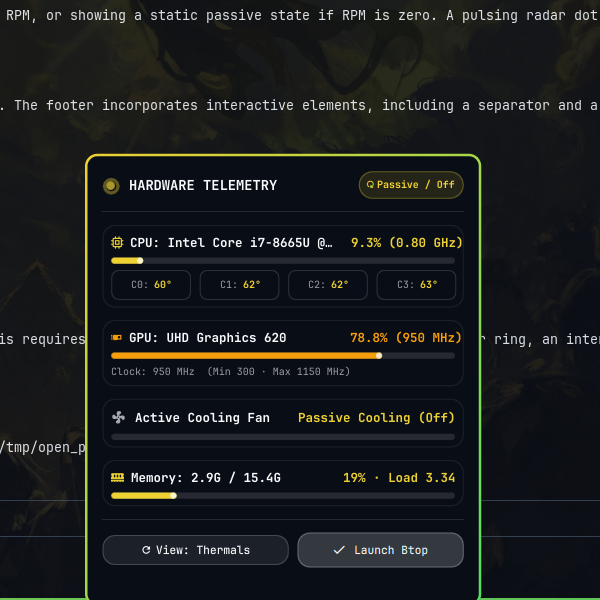

# omarchy-sysmon

A sleek, native **Hardware Monitor & Telemetry Dashboard** plugin for [Omarchy](https://omarchy.org/) Linux (Quickshell / Hyprland).

Designed from the ground up to follow Omarchy's minimalist aesthetic, typography, and live theme system.


<p align="center">
  
</p>

---

## ✨ Features

- **Seamless Bar Integration**: Built on Omarchy's native `WidgetButton` with matching monospace fonts, live theme coloring (`bar.barForeground`), and zero awkward pill borders.
- **4 Real-Time Interactive Views**:
  - **Mode 0 (Overview)**: CPU % · GPU % · Fan RPM / Off
  - **Mode 1 (Thermals)**: CPU Package Temp °C · Fan RPM
  - **Mode 2 (Frequencies)**: Average CPU GHz · Active GPU MHz
  - **Mode 3 (Memory & Load)**: RAM Used/Total (Used %) · 1-Minute System Load
- **Dynamic Hardware Detection**: Automatically detects your exact CPU model and GPU controller without manual configuration.
- **Detailed Telemetry Popup**:
  - CPU utilization bar and per-core temperature grid
  - GPU frequency and load scaling
  - Active cooling fan speed (RPM & percentage) with spinning fan animation
  - RAM utilization and load averages
  - One-click launcher for `btop` dashboard (using `omarchy launch or focus tui btop`)
- **Theme-Adaptive Urgent Alerts**: Lights up in your theme's urgent warning accent when CPU temp reaches $\ge 85^\circ\text{C}$ or utilization exceeds $90\%$.
- **Rich Interaction**:
  - **Left-Click**: Toggle the telemetry detail card.
  - **Right-Click / Scroll Wheel**: Cycle metric views.
  - **Keyboard Shortcuts** (when popup is open):
    - `B`: Launch or focus `btop`
    - `R`: Refresh hardware stats immediately
    - `Tab`: Switch bar metric mode
    - `Esc`: Dismiss popup
- **Shell IPC Support**: Full scriptable control via `omarchy-shell atomic.sysmon <method>`.

---

## 🚀 Installation

### 1. Clone into your Omarchy plugins directory:

```bash
git clone https://github.com/Madhukumar511/omarchy-sysmon.git ~/.config/omarchy/plugins/atomic.sysmon
```

### 2. Add to your status bar layout:

Open `~/.config/omarchy/shell.json` and add `{"id": "atomic.sysmon"}` into your desired bar section (e.g. `centerEnd` or `right`):

```json
{
  "bar": {
    "layout": {
      "centerEnd": [
        { "id": "omarchy.weather" },
        { "id": "atomic.sysmon" }
      ]
    }
  }
}
```

### 3. Reload the shell:

```bash
omarchy restart shell
```

---

## ⌨️ Shell IPC Commands

You can control the widget from scripts, shortcuts, or terminal:

```bash
# Toggle popup
omarchy-shell atomic.sysmon toggle

# Cycle metric view on the bar
omarchy-shell atomic.sysmon next
omarchy-shell atomic.sysmon prev

# Refresh sensors
omarchy-shell atomic.sysmon refresh
```

---

## 📄 License

MIT © [Madhukumar511](https://github.com/Madhukumar511)
